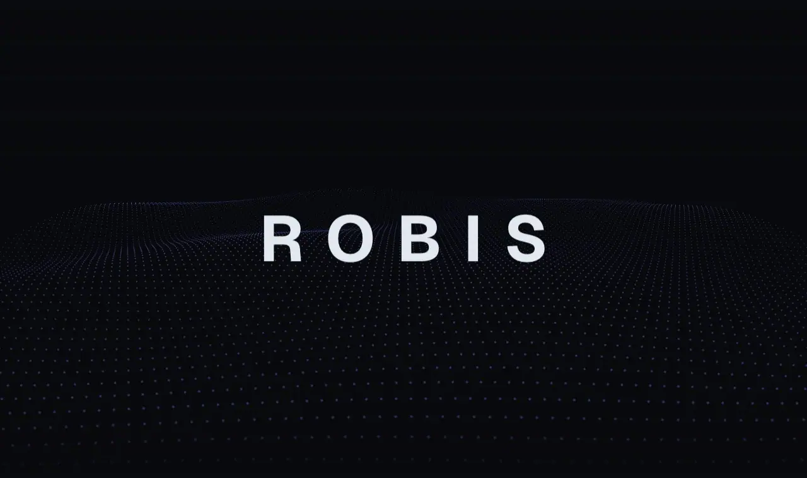
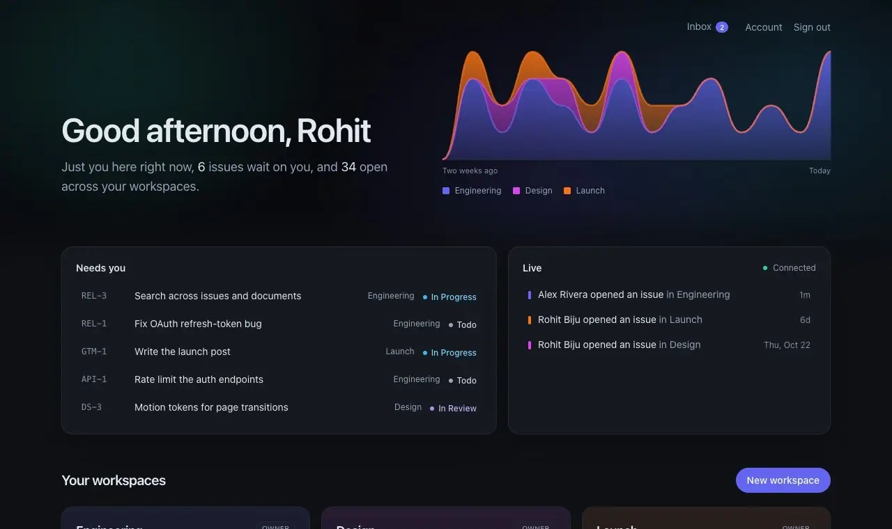
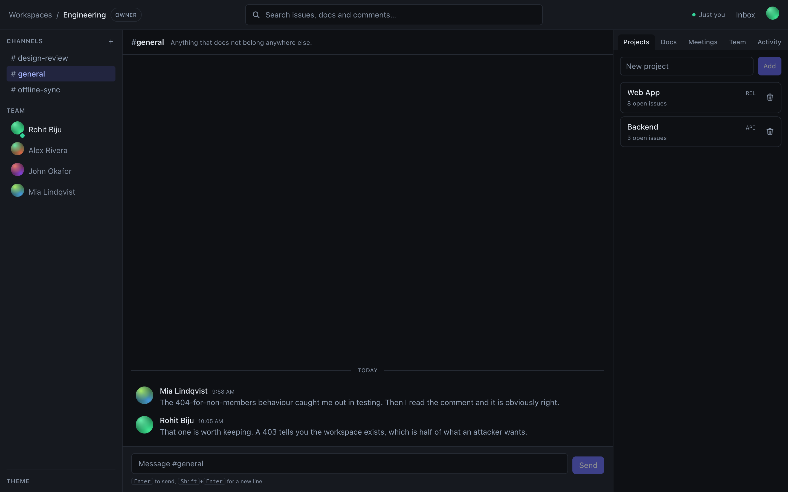
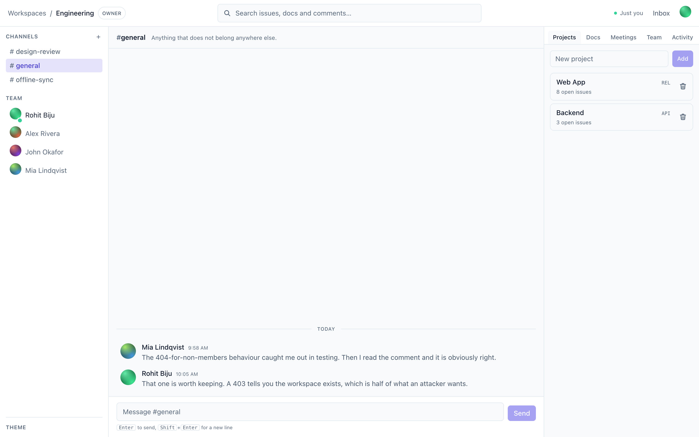
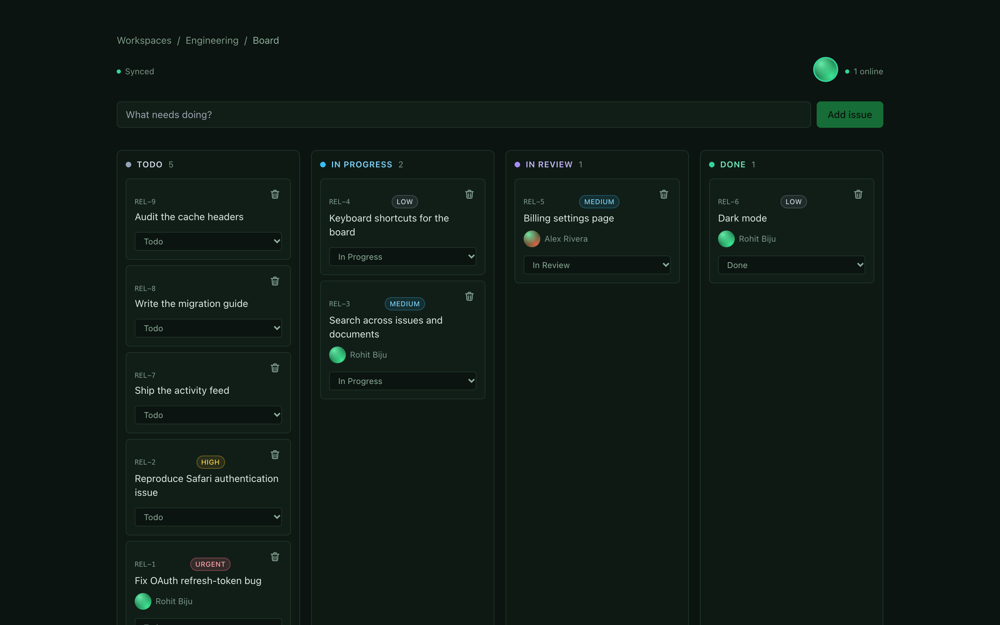

<p align="center">
  
</p>

<h1 align="center">Robis</h1>

<p align="center">
  <b>Your team's work, live. Even when the network is not.</b><br>
  Issues, documents, chat and meetings in one place. Every change reaches everyone as it happens,<br>
  and anything you do offline lands exactly once when you are back.
</p>

<p align="center">
  <a href="#try-it-in-two-minutes"><b>Try it</b></a>
  &nbsp;&nbsp;|&nbsp;&nbsp;
  <a href="docs/HOW_IT_WORKS.md">How it works</a>
  &nbsp;&nbsp;|&nbsp;&nbsp;
  <a href="docs/ARCHITECTURE.md">Architecture</a>
  &nbsp;&nbsp;|&nbsp;&nbsp;
  <a href="docs/WHATS_NEW.md">What's new</a>
  &nbsp;&nbsp;|&nbsp;&nbsp;
  <a href="docs/GETTING_STARTED.md">Run it yourself</a>
</p>

<p align="center">
  <a href="https://github.com/r7bb/Robis/actions/workflows/ci.yml"></a>
</p>

<br>

## Your team, live

Sign in to a sky of your workspaces, each in its own colour. When a
teammate changes something, a spark flies to where it happened, while it
happens.

<p align="center">
  
</p>

<br>

## Keep working when the network does not

Pull the cable mid-sentence. Your edits wait on the device and land exactly
once when you reconnect, in order, with nothing doubled.

<table>
  <tr>
    <td width="50%"></td>
    <td width="50%"></td>
  </tr>
  <tr>
    <td align="center"><sub>Offline: changes wait on the device</sub></td>
    <td align="center"><sub>Reconnected: each one lands once</sub></td>
  </tr>
</table>

<br>

## Write in the same sentence

Two people, one paragraph, no locks. Edits merge as you type, and nobody
loses a keystroke.


<br>

## Plan on a board that moves with you

Projects, statuses, priorities and assignees, with comments and
`@mentions`. Drag an issue and everyone sees it move.


<br>

## Talk, meet and decide where the work is

Channels for the conversation, meetings you can answer, and search across
every issue, document and comment.

<table>
  <tr>
    <td width="50%"></td>
    <td width="50%"></td>
  </tr>
  <tr>
    <td colspan="2"></td>
  </tr>
</table>

<br>

## Make each workspace its own

Six themes, chosen per workspace, so the team you are looking at is the
team you are working in.

<table>
  <tr>
    <td width="33%"></td>
    <td width="33%"></td>
    <td width="33%"></td>
  </tr>
</table>

<br>

## Built to be trusted

- **An audit trail you can check.** Every change is recorded in the same
  transaction, numbered, chained and signed with a key the database never
  holds. Edit a row behind the app's back and the check names the event.
- **Nothing to learn about who has an account.** Sign-up starts with your
  email and always says "check your inbox"; invitations answer the same.
- **A strict security policy on every page.** Only scripts the server
  stamped for that response run, nothing may frame the app, and a browser
  test in CI fails on any violation.
- **Outsiders get a 404, not a 403.** A workspace you are not in does not
  admit that it exists.

The details, and what each of these does not cover, are in
[How it works](docs/HOW_IT_WORKS.md). Nothing here is a security or
compliance claim: it describes what the code does and what was measured.

<br>

## Fast, and measured

<table>
  <tr>
    <td align="center"><h3>7.0 ms</h3><sub>median read, 25 issues</sub></td>
    <td align="center"><h3>9.8 ms</h3><sub>median write</sub></td>
    <td align="center"><h3>~3,600</h3><sub>requests a second, zero errors</sub></td>
    <td align="center"><h3>4.1 ms</h3><sub>for a write to reach 50 live clients</sub></td>
  </tr>
</table>

From the load harness in this repository (`bun run loadtest`), on one laptop
with Postgres on the same machine. Method and percentiles in
[How it works](docs/HOW_IT_WORKS.md).

<br>

## Latest

- **The landing loads its heavy parts as you reach them.** The field and
  the live demo download after the page is usable, as they come into view.
- **The benchmark counts what a write costs afterwards.** Follow-up reads
  per write, and refreshed figures.
- **Image uploads hold their line.** Decoding never passes its cap, and a
  flood is told when to come back.

Everything else, newest first, with how each was checked:
[What's new](docs/WHATS_NEW.md).

<br>

## Try it in two minutes

```bash
docker compose -f deploy/compose.yaml up --build --wait
```

Open <http://localhost:3000> and sign in as `rohit@robis.test` with
`robis-demo-password`. Three workspaces and a team of four are already
there, so there is nothing to set up. Development setup, every command and
what a deployment needs: [Run it yourself](docs/GETTING_STARTED.md).

<br>

---

<sub>
Every picture above is captured from the running app by scripts in this
repository (<code>bun run screenshots</code> and <code>bun run capture:motion</code>);
none is a mockup. Robis is a portfolio project: it runs locally and in CI and
has not been deployed. Where it stands, and what needs a legal review before
real users, is in <a href="docs/HOW_IT_WORKS.md">How it works</a>; what comes next is in
<a href="docs/ROADMAP.md">the roadmap</a>.
</sub>
