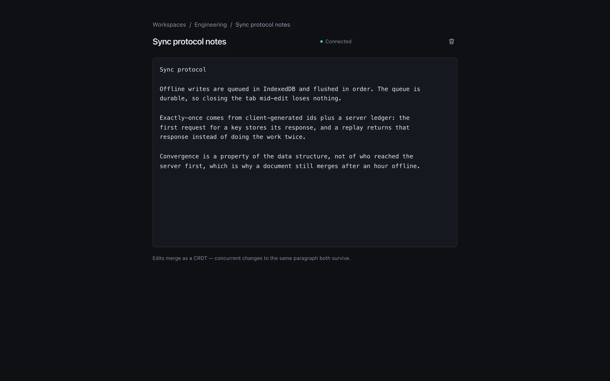
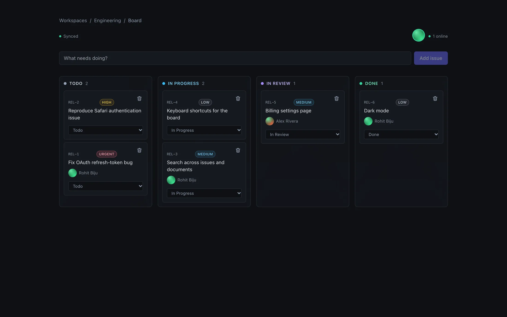
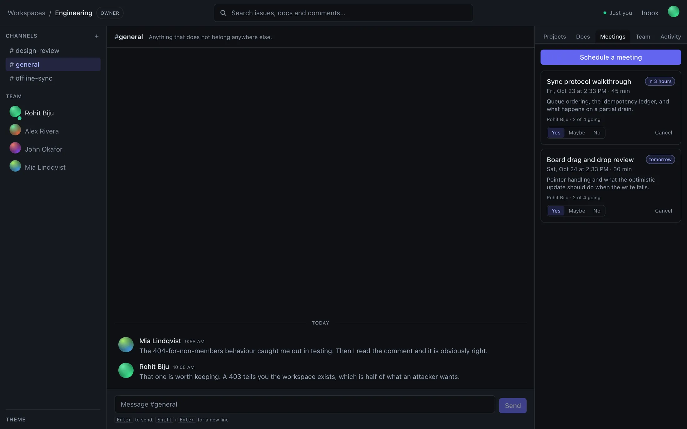
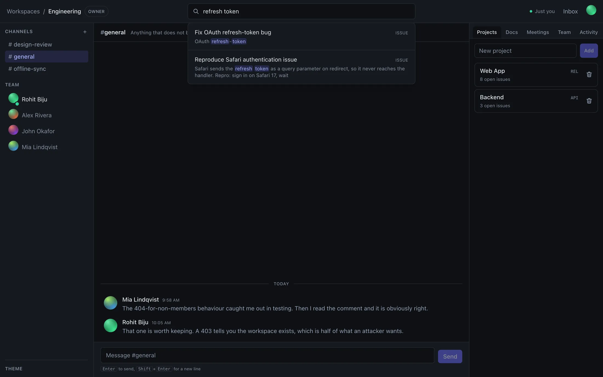
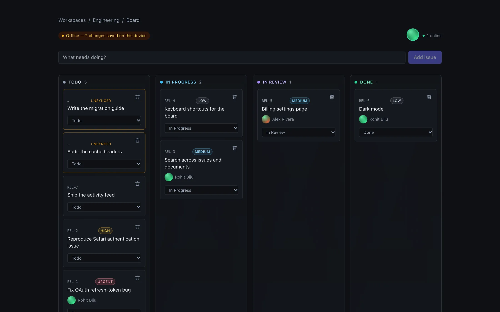
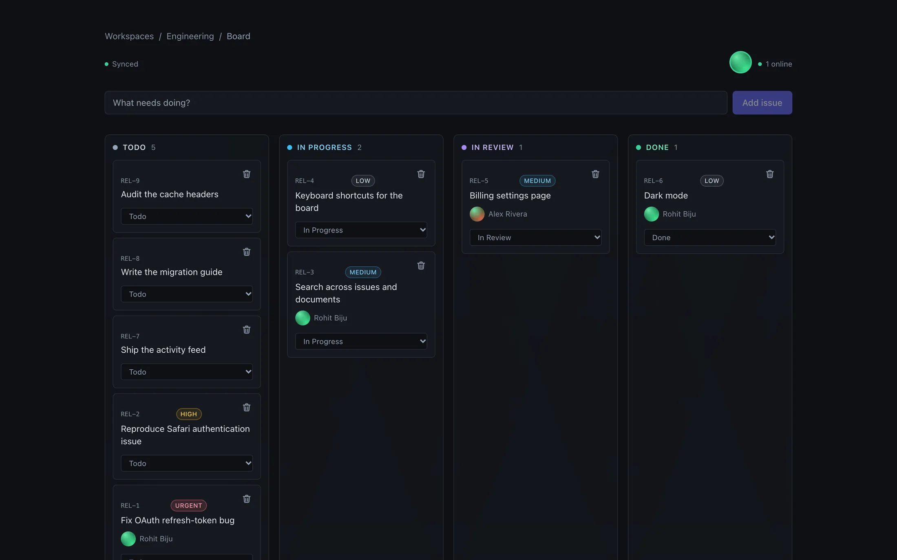

# How Robis works

The working details behind the [README](../README.md): what each part does
and how, what was measured, how the code is laid out and why, the machine
learning, and an honest account of where it stands. The long version of the
design decisions, with the rejected alternatives, is
[ARCHITECTURE.md](ARCHITECTURE.md).

## What it does

**Chat in channels.** Workspace rooms with history, moderation, and the same
permission rules as everything else.

**Documents that merge.** Two people can type in the same paragraph. Yjs CRDTs
over a WebSocket gateway, so edits converge without a lock and without losing a
keystroke.



**Issues on a board.** Projects, statuses, priorities, assignees, comments with
`@mentions`, and a full audit trail.



**Meetings.** Schedule, invite, answer. Moving the time clears everyone else's
yes, because a yes was for a time.



**Search across everything.** Issues, documents and comments, through Postgres
full-text search.



**An audit trail you can check.** Every change is written in the same
transaction as the change itself, so a rolled-back edit leaves no event. Each
workspace's events are numbered 1, 2, 3 and chained: every event stores a
hash of itself and of the one before, signed with a key the database never
holds. The app connects as a database role that can add audit events but
never change or remove them. Admins open **Security** from
the Activity tab to see who did what, filter it, check the chain, and export
it as JSON lines. Edit a row behind the app's back and the check names the
event and says how it was changed. Reading, exporting and checking the
trail are recorded in it too, and checks start where the last one ended,
from a checkpoint stored with a signature, so they stay quick as the trail
grows; a full check walks every event again.

What it does not catch on its own: someone with database access who rewrites
every event from the edit onwards, or drops the newest ones. That is what an
outside copy is for: the head hash shown in the security view, or the SIEM
stream described in [GETTING_STARTED.md](GETTING_STARTED.md).

---

## Works offline

Pull the network out mid-sentence. Writes land in a durable queue in IndexedDB
and the board keeps working.



On reconnect the queue drains in order. A server-side ledger keyed by a
client-generated id means a retry after an ambiguous failure cannot create the
same issue twice.



---

## Measured, not estimated

From the load harness in this repository (`bun run loadtest`), on one laptop
with Postgres on the same machine.

| Operation             | p50     | p95     | p99     |
| --------------------- | ------- | ------- | ------- |
| Read (list 25 issues) | 7.0 ms  | 11.0 ms | 12.2 ms |
| Write (create issue)  | 14.0 ms | 18.9 ms | 21.1 ms |

**~3,600 requests/second, zero errors.** A write reaches all 50 subscribed
clients in 4.1 ms at p50, and costs 14 follow-up reads across those 50 open
boards, each one 24 ms at p50. Details, and how to read them, in
[ARCHITECTURE.md](ARCHITECTURE.md).

---

## How it is put together

```text
frontend/        Next.js 15, React 19, Tailwind
backend/
  api/           Fastify HTTP API
  realtime/      Bun WebSocket gateway: fan-out, presence, document rooms
  worker/        background jobs
  auth/          Argon2id passwords, opaque sessions
  database/      Drizzle schema and migrations
  mailer/        mail port plus drivers
  metrics/       Prometheus registry
shared/
  contracts/     Zod schemas, the permission matrix, wire events
  sync/          offline queue, CRDT glue
robis-ml/        duplicate detection and priority triage (Python)
```

`shared/` is a third top-level directory rather than a folder inside
`backend/`, because the frontend genuinely imports it: `@robis/shared` and
`@robis/sync` are its only two workspace dependencies. Filing them under the
backend would misdescribe who uses them. The package is still named
`@robis/shared`; the directory is `contracts` because that is what is in it.

Four roles, one declarative permission matrix. Non-members get **404, not
403**. A 403 confirms the workspace exists, which is half of what an attacker
wants.

### A few decisions, and why

| Choice                    | Instead of     | Because                                                                                                          |
| ------------------------- | -------------- | ---------------------------------------------------------------------------------------------------------------- |
| Postgres `LISTEN/NOTIFY`  | Redis pub/sub  | The event publishes in the same transaction as the write, so an event cannot exist for a change that rolled back |
| Postgres `SKIP LOCKED`    | a queue broker | Jobs enqueue transactionally with the work that causes them. One fewer service to run                            |
| Keyset pagination         | `OFFSET`       | `OFFSET` re-counts every page and shifts under concurrent inserts, so readers skip rows and see others twice     |
| Opaque sessions           | JWTs           | A session dies the moment a password changes. A signed token stays valid until it expires                        |
| Postgres full-text search | Elasticsearch  | A stored generated `tsvector` cannot drift from the row it describes                                             |

Several of these are also "one fewer thing to run on a laptop with no Docker".
That constraint is real and is stated rather than dressed up.

The long version, with the rejected alternatives spelled out, is in
**[docs/ARCHITECTURE.md](ARCHITECTURE.md)**.

---

## Machine learning

`robis-ml/` finds possible duplicate issues and suggests a priority. Both are
advisory; nothing acts on a prediction.

TF-IDF rather than transformer embeddings, because one workspace's issues are
short and full of shared project vocabulary. The limitation is documented
honestly: "auth" matches at 0.64 where "authentication" matches at 0.26 for the
same intent. Below 40 triaged issues the model **declines to predict** rather
than returning a confident-looking guess.

It sits behind a shared service token and is wired into the issue composer:
typing a title shows possible duplicates and a suggested priority. If the service is missing, slow or
broken, the hints disappear and filing still works.

Duplicate detection is measured against a small labelled set, with the
threshold chosen on one half and reported on the other. It catches most
reworded duplicates and **none of the 7 that share almost no words** with the
original. The set was written by the author, so these are not production
figures. See **[robis-ml/README.md](../robis-ml/README.md)**.

---

---

## Built to be read

A portfolio project, built to be read. It runs locally and is tested, and
every service's container is built, started and driven end to end by CI on
every push. It has not been deployed. Nothing here is a security or
compliance claim: it describes what the code does and what was measured.

What is left, the known gaps, what waits on legal review and what is
deliberately not being built are in **[docs/ROADMAP.md](ROADMAP.md)**.
